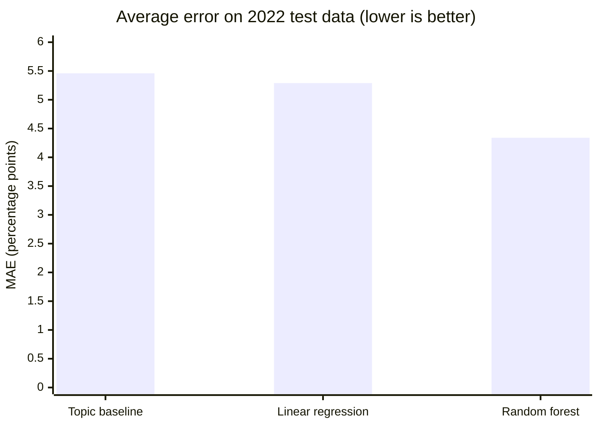

[](https://github.com/short-for-calculator/cognitive-decline-state-analysis/actions/workflows/ci.yml)
# Cognitive Decline State Analysis

Clusters U.S. states by how older adults report subjective cognitive decline (SCD), and trains regression models to predict a reported percentage from location, topic, age group, demographic group, and year.

Tested on 2022 data the model never saw, a random forest predicts within **4.34 percentage points** on average, compared with **5.46** for a baseline that only knows which survey question was asked.

Started as coursework for an AI/ML class, then revised to fix data leakage, encoding, and evaluation problems. See [What changed from the original version](#what-changed-from-the-original-version).

## Data

**Source:** CDC, *Alzheimer's Disease and Healthy Aging Data* (Behavioral Risk Factor Surveillance System survey), published on data.cdc.gov. U.S. government data, public domain.

**File:** `Alzheimers_Disease_dataset.xlsx` (in this repo, about 39 MB).

The script only uses rows where `Class == "Cognitive Decline"`. That subset has 22,182 rows and four topics:

| Topic | What the percentage measures | Mean |
|---|---|---|
| Subjective cognitive decline or memory loss | Share of adults 50+ reporting SCD | ~12% |
| Functional difficulties associated with SCD | Share of people **with SCD** whose daily functioning is affected | ~37% |
| Need assistance with day-to-day activities because of SCD | Share of people **with SCD** who need help | ~32% |
| Talked with a health care professional about SCD | Share of people **with SCD** who talked to a doctor | ~45% |

Only the first topic is a decline rate for the whole population. The other three are measured among people who already report SCD.

Each row is broken down by:

- **Location:** 50 states, DC, and Puerto Rico. National and regional totals are removed during cleaning.
- **Age group** (`Stratification1`): Overall, 50–64, and 65 or older
- **Demographic** (`Stratification2`): Overall, female, male, and five race and ethnicity groups
- **Year:** 2015–2022. Most rows cover a single year, and some are CDC estimates pooled over 2019–2022.

## How it works

`main.py` runs three steps, called in order from `main()`. Settings such as the test year, the pooled years, k, and the random seed are constants at the top of the file.

### 1. Cleaning (`clean`)

1. Keep only the cognitive decline rows (22,182).
2. Drop rows with no `Data_Value` (8,046 dropped).
3. Drop footnote columns and the duplicate `Data_Value_Alt` column.
4. Drop the national total and the four Census regions, which are built from the state rows and would count the same information twice. This leaves **9,952 rows**.
5. Fill a blank `Stratification2` with `"Overall"`.
6. Drop rows with no confidence interval (none remain after the earlier steps, but the check stays as a safeguard).

The cleaned table then forks into two branches, each filtering its own copy.

### 2. Clustering (`cluster`)

- Use only the CDC's pooled 2019–2022 estimates where both age group and demographic are `Overall`, so each location has exactly one value per topic for its whole 50+ population.
- Build a table with one row per location and one column per topic (49 locations; Massachusetts, Montana, and New Jersey have no pooled estimates).
- Scale each topic to 0–1 and compare K-means silhouette scores for k = 2 through 6.
- Run K-means with **k = 3**, then print each cluster's average topic rates and save every location's cluster to `results/state_clusters.csv`.

### 3. Prediction (`train_and_test`)

- **Rows:** single-year rows only (7,740). The pooled rows overlap with them, so they're left to clustering.
- **Features:** location, topic, age group, and demographic (one-hot encoded), plus `YearStart`
- **Target:** `Data_Value`, in percentage points
- **Split:** train on 2015–2021 (6,863 rows), test on 2022 (877 rows)
- **Models:** a topic-average baseline, linear regression, and a random forest (200 trees, max depth 12). Both models run inside scikit-learn pipelines, so encoding is learned from the training years only.
- **Output:** R² and mean absolute error (MAE) for each model, MAE by topic, and permutation importance for the random forest

## Results

### Model comparison

All models were trained on 2015–2021 and tested on 2022.

| Model | R² | MAE (percentage points) | Improvement over baseline |
|---|---|---|---|
| Topic-average baseline | 0.749 | 5.46 | — |
| Linear regression | 0.795 | 5.29 | 0.17 points |
| **Random forest** | **0.854** | **4.34** | **1.12 points (about 20%)** |



### MAE by topic

| Topic | Baseline | Linear regression | Random forest | Test rows |
|---|---|---|---|---|
| SCD | **1.81** | 4.50 | 2.21 | 249 |
| Functional | 7.39 | 4.87 | **4.71** | 210 |
| Needs help | 6.91 | **4.85** | 5.14 | 203 |
| Talked with provider | 6.44 | 7.01 | **5.68** | 215 |

Bold marks the lowest error in each row. The random forest improves on the baseline for the three follow-up topics, but neither model beats the baseline for the SCD rate itself, which varies little between groups. Linear regression is worse than the baseline on SCD and on talking with a provider, which is why its overall improvement is small.

### What the random forest relies on

Permutation importance shuffles one feature at a time in the 2022 test data and measures how much the error rises.

| Feature | MAE increase when shuffled (points) |
|---|---|
| Topic | 11.12 |
| Age group | 1.13 |
| Demographic | 1.00 |
| Location | 0.18 |
| Year | 0.00* |

\*Every test row is from 2022, so shuffling the year changes nothing. This method can't measure the year's importance with a single-year test set.

### Choosing the number of clusters

| k | Silhouette score | Cluster sizes |
|---|---|---|
| 2 | 0.244 | 28, 21 |
| **3** | **0.255** | **25, 3, 21** |
| 4 | 0.258 | 14, 12, 3, 20 |
| 5 | 0.273 | 21, 8, 11, 3, 6 |
| 6 | 0.252 | 15, 9, 9, 6, 3, 7 |

Every k scores between 0.24 and 0.27, so the locations overlap rather than forming sharply separate groups, and no k clearly wins. I chose k = 3 because it scores in line with the alternatives and gives groups that are easy to interpret. Read the clusters as broad tendencies, not distinct categories.

### Cluster map

**[View the interactive cluster map](results/state_clusters.geojson)**: click any state to see its cluster and its four topic rates.

| | Cluster | Locations | SCD | Functional | Needs help | Talked with provider |
|---|---|---|---|---|---|---|
| 🟦 | Lower impact (cluster 0) | 25 | 10.6% | 32.0% | 27.0% | 43.0% |
| 🟨 | Moderate (cluster 2) | 21 | 12.7% | 42.2% | 36.7% | 45.1% |
| 🟪 | High need (cluster 1) | 3 | 6.7% | 51.9% | 52.7% | 49.2% |
| ⬜ | No pooled 2019–2022 estimate | 3 | | | | |

Locations in each cluster (also in `results/state_clusters.csv`):

- **Lower impact:** Alaska, Arizona, California, Colorado, Connecticut, Delaware, Hawaii, Idaho, Iowa, Kansas, Maine, Maryland, Minnesota, Missouri, Nebraska, New Hampshire, North Dakota, Oregon, South Dakota, Utah, Vermont, Virginia, Washington, Wisconsin, Wyoming
- **Moderate:** Alabama, Arkansas, District of Columbia, Florida, Georgia, Indiana, Kentucky, Louisiana, Michigan, Mississippi, Nevada, New Mexico, New York, Ohio, Oklahoma, Pennsylvania, Rhode Island, South Carolina, Tennessee, Texas, West Virginia
- **High need:** Illinois, North Carolina, Puerto Rico
- **No estimate:** Massachusetts, Montana, New Jersey

## What the results mean

- **Topic explains most of the prediction.** The four topics have very different typical values, so knowing the topic alone reaches an R² of 0.749. The random forest improves that to 0.854, cutting the average error from 5.46 to 4.34 points by also using age group, demographic, location, and year.
- **Beyond topic, the gains come from knowing *who* was surveyed, not *where*.** Age group and demographic each add about a point of error when shuffled, while location adds less than a fifth of a point.
- **The model helps with how SCD affects daily life, not with the SCD rate itself.** The random forest cuts the error by about 2.7 points for functional difficulties and 1.8 points for needing help, but no model beats the baseline on the SCD rate, which stays close to its average across groups.
- **Linear regression's original weak score came from the encoding, not the model.** `LabelEncoder` gave each state an integer (Alabama = 0, Alaska = 1, and so on), so linear regression treated states as if they had a meaningful order. `OneHotEncoder` gives each category its own yes/no column (`is_Alabama`, `is_Arizona`, …), so the model learns a separate adjustment for each state. On the original random split, that one change raised linear regression's R² from about 0.01 to 0.81.
- **Linear regression can only add effects together.** It learns "Arizona adds X points" once for all topics, so it can't learn that a state differs by topic. The random forest can, which is why it beats linear regression on three of the four topics.
- **The clusters follow geography, even though location wasn't a clustering feature.** Most of the South falls in the moderate group, and most of the West and Plains fall in the lower-impact group.
- **Puerto Rico is unusual in two ways.** It used to form its own cluster. With the pooled 2019–2022 estimates, it now groups with Illinois and North Carolina, the three locations where the largest share of people with SCD (about 53%, versus 27–37% elsewhere) need help with daily activities. Yet it has the lowest SCD rate of all (about 7%).

## Known limitations

- **The target mixes four kinds of percentage.** The model predicts "the value for this topic," which is a share of all older adults for SCD but a share of people with SCD for the other three topics. The per-topic MAE table shows results for each separately.
- **Survey noise.** The median 95% confidence interval in this data is about 17 percentage points wide, so prediction errors of a few points are already within the survey's own uncertainty.
- **The clusters are weak.** Silhouette scores of 0.24–0.27 mean the locations sit on a continuum, and k = 3 was chosen for readability.
- **Self-reported data.** SCD is people's own sense of memory decline, not a clinical diagnosis.
- **Three states are missing from the clustering.** Massachusetts, Montana, and New Jersey have no pooled 2019–2022 estimates.
- **The test year is outside the training range.** The random forest can't extrapolate beyond 2021, so it treats 2022 like the latest training year. Linear regression extends its learned trend instead.

## What changed from the original version

1. **Removed national and regional totals.** About 4,100 rows were aggregates of the state rows, so the same information was counted more than once.
2. **Rebuilt the clustering table.** It used to average each cell over about 16 rows of different demographic groups and years. It now uses one pooled 2019–2022 estimate per location and topic, for the whole population.
3. **Separated overlapping time periods.** Pooled 2019–2022 rows overlapped with single-year rows. The model now trains on single-year rows only, and clustering uses the pooled rows.
4. **Stopped scaling the target.** Scaling happened before the train/test split and squeezed the target to 0–1. Errors are now reported in percentage points.
5. **Switched to one-hot encoding,** inside pipelines that learn categories from the training data only.
6. **Replaced the random 80/20 split with a time-based split.** A random split let the model train on rows from the same survey year as its test rows. Testing on 2022, a year the model never saw, gives a more honest score.
7. **Added a topic-average baseline,** per-topic MAE, and permutation importance, so the results show what the model adds and where.
8. **Justified k with silhouette scores** instead of choosing it by hand.
9. **Split `main.py` into functions** with an entry point guard, and moved settings into constants.

## Planned improvements

- [x] Treat topic explicitly as an input and compare against a topic-average baseline
- [x] Keep the target in percentage points, and fit preprocessing on training data only
- [x] Test on a later year instead of random rows
- [x] Add a cluster map and model comparison tables
- [x] Split `main.py` into functions
- [ ] Add a predicted vs. actual chart
- [ ] Add a download script instead of committing the data
- [x] Add tests and continuous integration
- [ ] Compare a second baseline that uses each state's past average for each topic

## Running it

Requires Python 3.11+.

```bash
git clone https://github.com/short-for-calculator/cognitive-decline-state-analysis.git
cd cognitive-decline-state-analysis
python -m venv .venv
source .venv/bin/activate
pip install -e .
python main.py
```

The script reads `Alzheimers_Disease_dataset.xlsx` from the current directory and takes under a minute to run. Results print to the terminal, and each location's cluster is saved to `results/state_clusters.csv`.

## Project structure

```
main.py                          cleaning, clustering, and regression
Alzheimers_Disease_dataset.xlsx  CDC source data
pyproject.toml                   dependencies and tool settings
results/state_clusters.csv       every location's cluster and topic rates
results/state_clusters.geojson   interactive cluster map
LICENSE                          MIT
```

## License

MIT. See `LICENSE`. The dataset is U.S. government public-domain data from the CDC.
