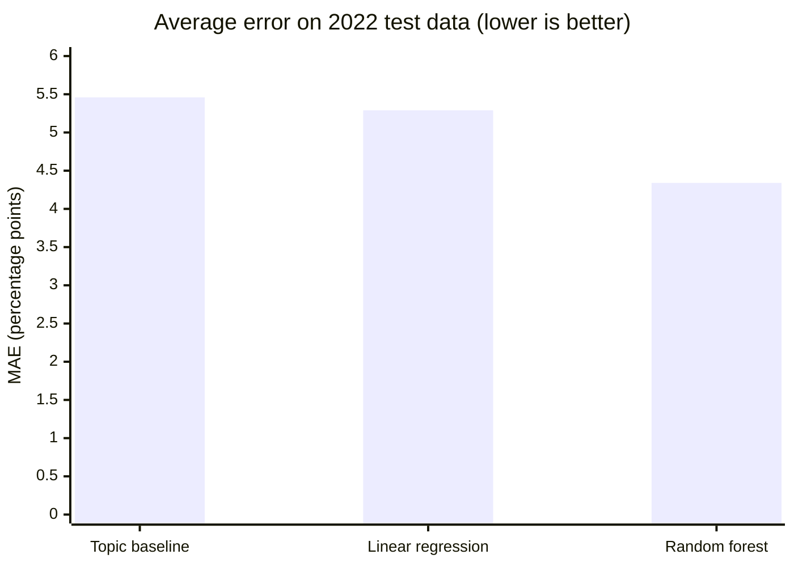

# Cognitive Decline State Analysis

Clusters U.S. states by how older adults report subjective cognitive decline (SCD), and trains regression models to predict a reported percentage from location, topic, age group, demographic group, and year.

Started as coursework for an AI/ML class.

## Data

**Source:** CDC, *Alzheimer's Disease and Healthy Aging Data* (Behavioral Risk Factor Surveillance System survey), published on data.cdc.gov. U.S. government data, public domain.

**File:** `Alzheimers_Disease_dataset.xlsx` (in this repo, about 38 MB).

The script only uses rows where `Class == "Cognitive Decline"`. That subset has 22,182 rows and four topics:

| Topic | What the percentage measures | Mean |
|---|---|---|
| Subjective cognitive decline or memory loss | Share of adults 45+ reporting SCD | ~12% |
| Functional difficulties associated with SCD | Share of people **with SCD** whose daily functioning is affected | ~39% |
| Need assistance with day-to-day activities because of SCD | Share of people **with SCD** who need help | ~34% |
| Talked with a health care professional about SCD | Share of people **with SCD** who talked to a doctor | ~45% |

Only the first topic is a decline rate for the whole population. The other three are measured among people who already report SCD.

Each row is broken down by:

- **Location:** 50 states, DC, Puerto Rico.
- **Age group** (`Stratification1`): Overall
- **Demographic** (`Stratification2`): Overall
- **Year:** 2015–2022. Most rows cover a single year, and some cover the pooled range 2019–2022.

## How it works

`main.py` runs top to bottom in three stages.

### 1. Cleaning

1. Keep only the cognitive decline rows (22,182).
2. Drop rows with no `Data_Value` (8,046 dropped).
3. Drop footnote columns and the duplicate `Data_Value_Alt` column.
4. Fill a blank `Stratification2` with `"Overall"`.
5. Drop rows with no confidence interval. This leaves **14,039 rows**.
6. Label-encode location, topic, age group, and demographic as integers.
7. Min-max scale `YearStart`, `Data_Value`, and the confidence limits to 0–1.

### 2. Clustering (unsupervised)

- Build a table with one row per location and one column per topic, using rows where age group is `Overall`.
- Scale it and run **K-means with k = 3**.
- Print the average value of each topic per cluster and the first six locations in each cluster.

### 3. Prediction (supervised)

- **Features:** encoded location, topic, age group, demographic, and `YearStart`
- **Target:** `Data_Value` (scaled 0–1)
- **Split:** random 80/20 train/test (`random_state=42`)
- **Models:** linear regression, and a random forest (200 trees, max depth 12)
- **Output:** R², mean absolute error, and random forest feature importances

## Results

Output of `python main.py`:

```
(22182, 31)
dropped 8046 rows with no Data_Value
final shape: (9952, 28)
Topic    Functional difficulties associated with subjective cognitive decline or memory loss among older adults  ...  Talked with health care professional about subjective cognitive decline or memory loss
cluster                                                                                                          ...                                                                                        
0                                                     32.0                                                       ...                                               43.0                                     
1                                                     51.9                                                       ...                                               49.2                                     
2                                                     42.2                                                       ...                                               45.1                                     

[3 rows x 4 columns]
cluster 0 -> ['Alaska', 'Arizona', 'California', 'Colorado', 'Connecticut', 'Delaware']
cluster 1 -> ['Illinois', 'North Carolina', 'Puerto Rico']
cluster 2 -> ['Alabama', 'Arkansas', 'District of Columbia', 'Florida', 'Georgia', 'Indiana']
linear regression -> r2: 0.812 mae: 5.19
random forest -> r2: 0.869 mae: 4.11

Process finished with exit code 0
```

Cluster averages and MAE are on the 0–1 scaled range, not in percentage points. The cluster lists are cut off at six locations each.

### Silhouette scoring for k number of clusters ###

| k | Silhouette score | Cluster sizes |
|---|---|---|
| 2 | 0.244 | 28, 21 |
| 3 | 0.255 | 25, 3, 21 |
| 4 | 0.258 | 14, 12, 3, 20 |
| 5 | 0.273 | 21, 8, 11, 3, 6 |
| 6 | 0.252 | 15, 9, 9, 6, 3, 7 |

- **Silhouette scores are too low to form sharply distinct groups.** The choice for k = 3 is just to keep clusters readable and easy to interpret. The three clusters should be viewed as one lower-impact group, one moderate group, and one high-need group, ("high-need" refers to, of the people who reported SCD, 53% needed assistance due to SCD, as opposed to the other clusters coming in at 27% and 37%). 

### What the results mean

- **Topic explains most of the prediction.** The four topics have very different typical values, so knowing the topic gets you most of the way. Predicting each topic's average alone scores R² of about 0.63. The random forest improves that to 0.81 by also using location, demographic, age, and year.
Linear regression’s weak score came from the encoding, not the model. LabelEncoder gave each state an integer (Alabama = 0, Alaska = 1, and so on), so linear regression treated states as if they had a meaningful order. Switching to OneHotEncoder gives each category its own yes/no column (is_Alabama, is_Arizona, …), so the model learns a separate adjustment for each state with no fake ordering. With that one change, linear regression’s R² rose from about 0.01 to 0.81.
- ~**Puerto Rico forms its own cluster** because its values are far from every state's. With min-max scaling, one outlier like this can take a whole cluster.~
  - Puerto Rico used to form its own cluster. After switching to the CDC’s pooled 2019–2022 estimates for the whole population, it now groups with Illinois and North Carolina, the three locations where the largest share of people with SCD report needing help with daily activities. It still stands out for having the lowest SCD rate (about 7%).

## Cluster map

**[View the interactive cluster map](results/state_clusters.geojson)**: click any state to see its cluster and its four topic rates.

| | Cluster | Locations | SCD | Functional | Needs help | Talked with provider |
|---|---|---|---|---|---|---|
| 🟦 | Lower impact (cluster 0) | 25 | 10.6% | 32.0% | 27.0% | 43.0% |
| 🟨 | Moderate (cluster 2) | 21 | 12.7% | 42.2% | 36.7% | 45.1% |
| 🟪 | High need (cluster 1) | 3 | 6.7% | 51.9% | 52.7% | 49.2% |
| ⬜ | No pooled 2019–2022 estimate | 3 | | | | |

Locations in each cluster:

- **Lower impact:** Alaska, Arizona, California, Colorado, Connecticut, Delaware, Hawaii, Idaho, Iowa, Kansas, Maine, Maryland, Minnesota, Missouri, Nebraska, New Hampshire, North Dakota, Oregon, South Dakota, Utah, Vermont, Virginia, Washington, Wisconsin, Wyoming
- **Moderate:** Alabama, Arkansas, District of Columbia, Florida, Georgia, Indiana, Kentucky, Louisiana, Michigan, Mississippi, Nevada, New Mexico, New York, Ohio, Oklahoma, Pennsylvania, Rhode Island, South Carolina, Tennessee, Texas, West Virginia
- **High need:** Illinois, North Carolina, Puerto Rico
- **No estimate:** Massachusetts, Montana, New Jersey

Location was not a clustering feature, yet the clusters follow geography: most of the South falls in the moderate group, while most of the West and Plains fall in the lower-impact group.

## Model comparison

All models were trained on 2015–2021 and tested on 2022.

| Model | R² | MAE (percentage points) | Improvement over baseline |
|---|---|---|---|
| Topic-average baseline | 0.749 | 5.46 | — |
| Linear regression | 0.795 | 5.29 | 0.17 points |
| **Random forest** | **0.854** | **4.34** | **1.12 points (about 20%)** |



### MAE by topic

| Topic | Baseline | Linear regression | Random forest | Test rows |
|---|---|---|---|---|
| SCD | **1.81** | 4.50 | 2.21 | 249 |
| Functional | 7.39 | 4.87 | **4.71** | 210 |
| Needs help | 6.91 | **4.85** | 5.14 | 203 |
| Talked with provider | 6.44 | 7.01 | **5.68** | 215 |

Bold marks the lowest error in each row. The random forest improves on the baseline for the three follow-up topics, but neither model beats the baseline for the SCD rate itself, which varies little between groups. Linear regression is worse than the baseline on SCD and on talking with a provider, which is why its overall improvement is small.

## Planned improvements

- [x] Predict one topic at a time, or treat topic explicitly as an input and compare against a topic-average baseline
- [x] Keep the target in percentage points, and fit scalers on training data only
- [x] Hold out whole groups or later years in testing, not just random rows
- [x] Add charts: a cluster map, predicted vs. actual values, and feature importance
- [x] Split `main.py` into functions, add a download script instead of committing the data, and add tests

## Running it

Requires Python 3.11+.

```bash
git clone https://github.com/short-for-calculator/cognitive-decline-state-analysis.git
cd cognitive-decline-state-analysis
pip install -r requirements.txt
python main.py
```

The script reads `Alzheimers_Disease_dataset.xlsx` from the current directory and takes about 20 seconds to run.

## Project structure

```
main.py                          cleaning, clustering, and regression
Alzheimers_Disease_dataset.xlsx  CDC source data
requirements.txt                 pandas, openpyxl, scikit-learn
LICENSE                          MIT
```

## License

MIT. See `LICENSE`. The dataset is U.S. government public-domain data from the CDC.
